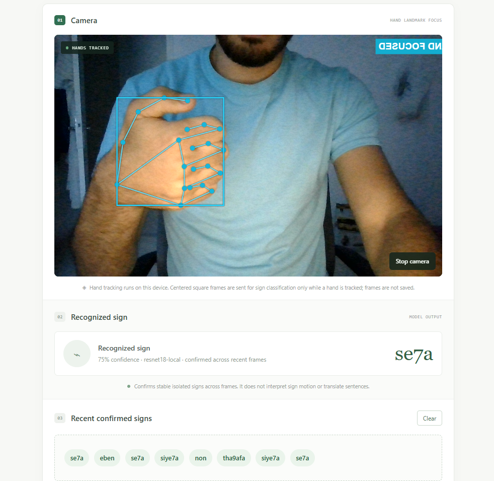

# Tunisian Sign Language Recognition

An academic prototype that recognizes supported, **isolated Tunisian Sign Language (TSL) signs** from camera frames. The user signs in front of a camera; on-device hand tracking draws landmarks and a box over detected hands, then the GPU-backed image classifier predicts one of the dataset's 57 labels.

This project does not yet recognize continuous signing, interpret motion, or translate sentences. It is a research prototype, not a complete sign-language translator.

## Project overview

The current data flow is:

```text
Webcam → browser hand tracking and overlay → sampled square frame
       → FastAPI → PyTorch classifier on CUDA → predicted sign and confidence
```



The W7CH dataset contains 4,423 labeled still images across 57 signs. The current train/validation/test split is not signer independent because signer IDs are unavailable. The system's held-out image results should not be treated as a guarantee of live-camera accuracy.

Implementation details and phase status are in [TSL-Recognition-Implementation-Progress.md](TSL-Recognition-Implementation-Progress.md). The contributor runbook is [setup.md](setup.md), the plain-language progress explanation is [PROJECT-PROGRESS-EXPLANATION.md](PROJECT-PROGRESS-EXPLANATION.md), and the academic draft is [docs/RESEARCH-REPORT-DRAFT.md](docs/RESEARCH-REPORT-DRAFT.md).

## Folder structure

```text
backend/
└── app/main.py                  FastAPI API and CUDA inference
ml-pipeline/
├── config.json                 Dataset, split, training, and evaluation settings
├── src/                         Dataset loader, models, train/evaluate scripts
├── tools/                       Dataset audit and split-generation scripts
├── archive/                     Preserved legacy helper
├── requirements.txt             CUDA PyTorch and API dependencies
└── requirements-audit.txt       Lightweight audit dependencies
frontend/
├── package.json                 Frontend dependencies and pnpm scripts
├── pnpm-lock.yaml               Locked frontend dependency versions
├── public/hand_landmarker.task  Browser hand-tracking model
└── src/
    ├── components/              Each component has its own folder and CSS
    ├── services/                API client
    └── App.tsx                   Page composition
data/
├── original/                    Original dataset; keep unchanged
├── metadata/                    Audit reports
└── splits/                      Versioned data manifests
experiments/                     Model checkpoints and evaluation outputs
docs/                            Technical, contribution, and research documents
```

Original data and experiment outputs are kept separate from source code. Large data and experiment artifacts are excluded from Git. Each frontend component lives in its own directory with its `.tsx` and `.css` files; shared panel styles are in `frontend/src/components/shared/PanelStyles.css`.

## Technologies used

| Area                 | Technology                                          |
| -------------------- | --------------------------------------------------- |
| Frontend             | React, TypeScript, Vite, Node.js, pnpm              |
| Camera               | Browser MediaDevices API                            |
| Hand landmarks       | MediaPipe Tasks Vision, GPU delegate in the browser |
| API                  | Python, FastAPI, Uvicorn                            |
| Image classification | PyTorch and Torchvision, CUDA GPU                   |
| Image handling       | Pillow                                              |
| Dataset and metrics  | pandas, NumPy                                       |

OpenCV is not currently used by the implementation.

## Quick manual installation

Use Windows PowerShell. Install Python 3.15, Node.js, pnpm 9.15.9, Git, and NVIDIA drivers first. The pinned PyTorch CUDA wheel contains a CPython 3.15 extension. Training, evaluation, and model inference require an NVIDIA GPU with a working CUDA driver.

```powershell
python --version
node --version
pnpm --version
```

### 1. Set up the Python backend

Create a Python environment and install the backend and model dependencies:

```powershell
python --version  # confirm Python 3.15.x
python -m venv .venv
.\.venv\Scripts\Activate.ps1
python -m pip install --upgrade pip
python -m pip install -r ml-pipeline/requirements.txt
```

Verify CUDA before training or starting the API:

```powershell
python -c "import torch; print('CUDA available:', torch.cuda.is_available()); print('GPU:', torch.cuda.get_device_name(0) if torch.cuda.is_available() else 'unavailable'); assert torch.cuda.is_available(), 'CUDA is required'"
```

### 2. Prepare the dataset and model

Download the [W7CH dataset](https://github.com/W7CH/First-ever-Tunisian-Sign-Language-Dataset) into `data/original/w7ch/`, preserving its folders. Do not edit the original images.

Audit the dataset, create the versioned splits, then train and evaluate a model:

Pipeline paths, split ratios, and model settings (including learning rate
and weight decay) are in [`ml-pipeline/config.json`](ml-pipeline\config.json). The scripts use these
values by default; their CLI options can still override them.

```powershell
python ml-pipeline/tools/audit_dataset.py
python ml-pipeline/tools/create_splits.py
python ml-pipeline/src/train.py
python ml-pipeline/src/evaluate.py
```

### 3. Install the frontend separately

Open a second PowerShell window, go to the frontend folder, and install its Node.js packages:

```powershell
cd frontend
pnpm install
```
---
### 4. Run the full App (backend and frontend)

In the first window, still at the project root, activate `.venv` if needed, select the checkpoint, then start FastAPI:

```powershell
.\.venv\Scripts\Activate.ps1
$env:TSL_DEVICE = 'cuda'
$env:TSL_EXPERIMENT_DIR = 'experiments/resnet18-local'
python backend/app
```
**note:** you can change backend port from: [`__main__.py`](backend/app/__main__.py)

In the frontend window, from the `frontend` directory, start Vite. The API URL defaults to `http://127.0.0.1:8000`:

```powershell
pnpm dev
```

Set `VITE_TSL_API_URL` only if the backend is running at a different URL. You can change the frontend port in [vite.config.ts](frontend/vite.config.ts).

Open `http://127.0.0.1:5173`. Stop each service with `Ctrl+C` in its own PowerShell window. The detailed phase-by-phase instructions are in [setup.md](setup.md).
